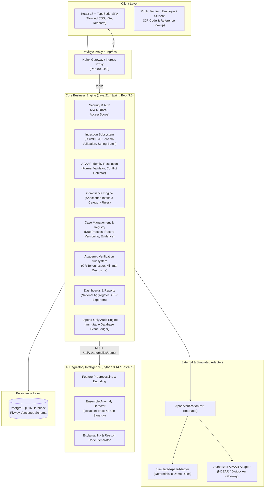

# System Architecture & Component Boundaries

## 1. Executive Architecture Overview

The **APAAR ID-Based Student Data Management and Verification Platform** is engineered to provide end-to-end data governance, regulatory compliance monitoring, automated anomaly detection, and academic verification for technical education institutions under the purview of the **All India Council for Technical Education (AICTE)**.

---

## 2. Component Responsibilities & Boundaries

### 2.1 Frontend Application (`frontend/`)
- **Technology:** React 18, TypeScript, Vite, Tailwind CSS, Recharts, React Router v6.
- **Role:** High-performance, accessible portal for AICTE Officers, Institution Administrators, Operators, Case Reviewers, and Public Verifiers.
- **Isolation:** Client-side role gating is provided strictly for ergonomic navigation. The UI never contains hardcoded secrets or privileged bypass logic; all capabilities require server-signed JWT claims.
- **Timezone Awareness:** Timestamps received in ISO 8601 UTC are rendered in Indian Standard Time (`Asia/Kolkata`, IST).

### 2.2 Core Java Backend (`backend/`)
- **Technology:** Java 21, Spring Boot 3.5, Spring Security, Spring Data JPA, Hibernate, Apache POI, ZXing, Flyway.
- **Role:** The definitive system of record, orchestration engine, and security enforcer.
- **Boundaries:**
  - Manages database transactions with ACID guarantees.
  - Enforces institution data isolation through `AccessScopeService`. An institutional user can never mutate or read another institution's records.
  - Manages record versioning (`student_record_versions`) ensuring non-destructive data updates.
  - Generates tamper-evident QR verification tokens and cryptographically signed references.

### 2.3 Python AI Regulatory Service (`ai-service/`)
- **Technology:** Python 3.14, FastAPI, Pandas, NumPy, Scikit-learn, Pydantic v2.
- **Role:** Explainable anomaly detection and regulatory intelligence.
- **Boundaries:**
  - The AI service is strictly **advisory and investigatory**. It cannot execute legal or administrative disciplinary actions.
  - Evaluates institutional admission distributions against peer baselines to flag suspicious patterns (e.g. cluster enrolments on final admission day, sudden category surges, repeat duplicate signals).
  - Supplies explainable reason codes with feature contribution scores for human case reviewers.

### 2.4 Integration Adapters (`integration/` & `com.apaar.platform.apaar`)
- **Technology:** Java Interface (`ApaarVerificationPort`) with pluggable implementations.
- **Simulated Adapter:** Provides deterministic, label-explicit mock responses for hackathon evaluations when government credentials are unavailable.
- **Authoritative Adapter:** Documented specification for NDEAR / APAAR API integration with mutual TLS and signed tokens.

### 2.5 PostgreSQL Database (`database/`)
- **Technology:** PostgreSQL 16.
- **Role:** Source of truth with strict relational constraints, foreign keys, and custom triggers preventing unauthorized audit modifications.

---

## 3. Communication Protocols & Security Boundaries

| Link | Protocol | Payload | Authentication / Security |
| :--- | :--- | :--- | :--- |
| **Frontend → Backend** | HTTP/2 (via Nginx) | JSON | Bearer JWT (HMAC-SHA256, 15 min TTL, rotated refresh tokens) |
| **Public Verifier → Backend** | HTTP/2 | JSON | Public reference token; rate-limited; minimal disclosure |
| **Backend → AI Service** | HTTP/1.1 REST | JSON | Container-internal network, timeout bounded (2s connect, 10s read) |
| **Backend → PostgreSQL** | TCP / JDBC | Binary (Postgres wire) | HikariCP pool, parameterized queries, non-root database credentials |
| **Prometheus → Backend / AI** | HTTP/1.1 | Plaintext metrics | Internal network scrape (`/actuator/prometheus`, `/metrics`) |

---

## 4. Key Architectural Decisions (ADRs)

1. **ADR-001: Separation of Student Identity from Enrolment**
   - *Context:* A student may legitimately enrol in a diploma and later a degree, or transfer between institutions across academic years.
   - *Decision:* A distinct `students` entity maintains identity (name, DOB, APAAR ID), while `enrolments` binds a student to an institution, programme, and academic year.
   - *Impact:* Prevents false fraud alerts on legitimate multi-year educational progression.

2. **ADR-002: Distinction between APAAR Format Validation and Authoritative Verification**
   - *Context:* Checking whether a string has 12 digits does not confirm that the student exists in the government registry.
   - *Decision:* Two distinct tables and statuses: `apaar_format_validations` (syntax) and `apaar_verification_records` (authoritative registry match).

3. **ADR-003: Append-Only Immutable Audit Engine**
   - *Context:* Regulatory compliance platforms require tamper-proof audit trails.
   - *Decision:* Database-level PostgreSQL trigger `reject_audit_mutation()` outright rejects `UPDATE` and `DELETE` queries on `audit_events`.

4. **ADR-004: Advisory Role for Machine Learning Models**
   - *Context:* AI hallucination or classification false positives cannot disenfranchise students.
   - *Decision:* Deterministic rules govern hard legal limits (e.g., sanctioned intake capacity). AI flags statistical anomalies for human officer triage and investigation case assignment.

