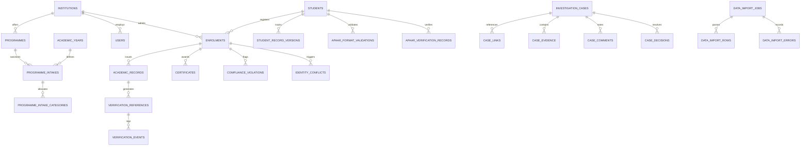

# Database Architecture & Schema Specification

## 1. Design Principles

1. **Entity Separation:** Student identity (`students`) is isolated from institutional enrolment (`enrolments`).
2. **Immutability & Provenance:** Audit logs, verification events, and student record versions are append-only.
3. **Timezone Consistency:** All timestamp columns use `TIMESTAMPTZ` (stored in UTC), and local rendering is set to Indian Standard Time (IST, UTC+05:30).
4. **Idempotency & Partial Constraints:** Active duplicates across programmes or academic years are enforced via partial unique indexes (`WHERE status IN ('PROVISIONAL','ACTIVE')`).
5. **Traceable Errors:** Import jobs retain row-level normalized payloads and specific error records for audit and bulk corrections.

---

## 2. Entity Relationship Overview

---

## 3. Core Tables and Cardinalities

### 3.1 Institutions & Academic Sanction
- `institutions`: Primary organization profile with unique `code`, status, type, and contact details.
- `programmes`: Specific degree courses offered by an institution (e.g., Computer Science B.Tech, MBA).
- `academic_years`: Defined academic fiscal cycles (`2026-27`). A partial unique index ensures only one year is marked active at a time.
- `programme_intakes`: Approved intake capacity per programme per year, distinguishing approved, supernumerary, NRI, OCI, and foreign national quotas.
- `programme_intake_categories`: Sanctioned seat limits partitioned by quota: `GENERAL`, `OBC`, `SC`, `ST`, `EWS`, `NRI`, `OCI`, `FOREIGN_NATIONAL`, `SUPERNUMERARY`.

### 3.2 Students & Record Versioning
- `students`: Unified student identity table containing `apaar_id`, `full_name`, `date_of_birth`, `gender`, `category`. Unique index on `apaar_id WHERE apaar_id IS NOT NULL`.
- `student_record_versions`: Historical snapshots (`JSONB`) capturing every amendment, `change_reason`, and modifying user ID.

### 3.3 Admissions & Enrolments
- `enrolments`: Institution-specific enrolment binding student to programme, academic year, and category.
  - Constraint: `enrolments_active_student_programme_year_uq` ensures no student can have multiple active enrolments in the same programme and academic year.
- `data_import_jobs`: Metadata for bulk CSV/Excel ingestion with checksums, uploaded row counts, and status tracking.
- `data_import_rows`: Normalized row payloads and status (`PENDING`, `VALID`, `INVALID`, `IMPORTED`, `RECONCILED`).
- `data_import_errors`: Row-number, column-name, and error-code mapping for failed records.

### 3.4 Identity Resolution & Verification
- `apaar_format_validations`: Syntax checking records (12 digits, valid characters, validation timestamp).
- `apaar_verification_records`: Gateway/adapter query records storing `verification_mode` (`SIMULATED` vs `AUTHORIZED`), `adapter_name`, provider reference, and raw verification payload.
- `identity_conflicts`: Cross-institution active enrolment conflicts, duplicate APAAR identity flags, and assignment metadata.

### 3.5 Regulatory Compliance & AI Intelligence
- `admission_rules`: Configurable baseline rules (`INTAKE_LIMIT`, `CATEGORY_CAPACITY`, `DUPLICATE_ENROLMENT`) with JSON configuration and severity levels.
- `compliance_evaluations`: Formal audit runs executed against an institution's enrolments for a given academic year.
- `compliance_violations`: Discrete violation findings linked to rule, enrolment, reason code, and resolution status.
- `anomaly_runs`: Batches of ML evaluation queries executed by the Python AI service.
- `anomaly_results`: Individual flagged records with `anomaly_score`, `threshold`, reason codes, feature snapshots, and triage status.

### 3.6 Case Management & Academic Verification
- `investigation_cases`: Formal case file (`CASE-2026-XXXX`) with priority, status (`OPEN`, `ASSIGNED`, `IN_REVIEW`, `RESOLVED`), and assignee.
- `case_links`: Polymorphic links associating cases with `IDENTITY_CONFLICT`, `COMPLIANCE`, or `ANOMALY` entities.
- `case_evidence`: Evidentiary files, document checksums (SHA-256), and provenance records.
- `case_decisions`: Formal disciplinary or corrective actions recorded by authorized officers.
- `academic_records`: Semester grades, credits earned, SGPA, and CGPA.
- `verification_references`: Public lookup tokens (`public_ref`), expiry timestamps, max uses, and use counters.
- `verification_events`: Immutable log of public and employer lookup queries.
- `certificates`: Issued diploma/degree certificates with cryptographic checksums.

### 3.7 System Auditing
- `audit_events`: Append-only system log protected by PostgreSQL trigger `reject_audit_mutation()`.
- `idempotency_keys`: Stores request signatures and response bodies to prevent duplicate operations.
- `retention_policies`: Legal retention requirements per entity type.

---

## 4. Migration Strategy

- **Tool:** Flyway.
- **Location:** `database/migrations/` (copied to backend classpath `db/migration` during build).
- **Files:**
  - `V1__initial_schema.sql`: Full DDL, constraints, indexes, triggers, and foreign keys.
  - `V2__reference_data.sql`: System roles, permissions, role-permission matrix, baseline admission rules, and default retention policies.
- **Demo Seed:** `database/seed/V100__demo_seed.sql` applied only when `SPRING_PROFILES_ACTIVE=demo`.

