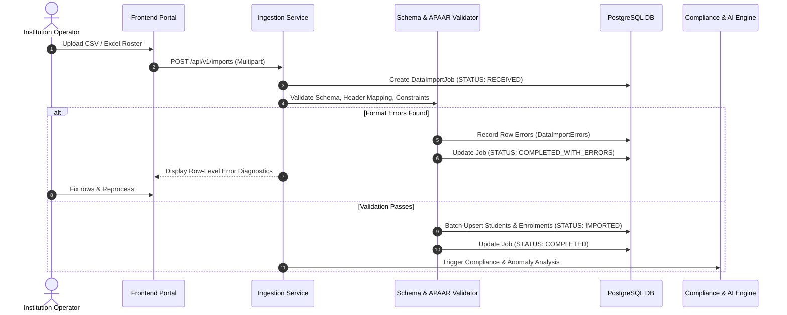
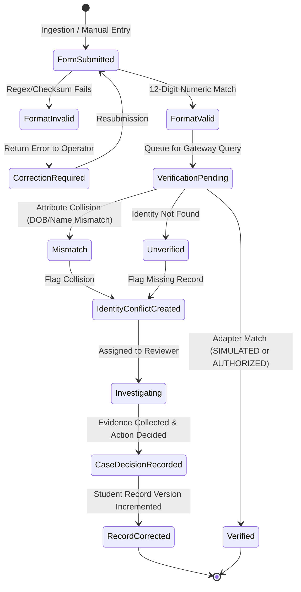
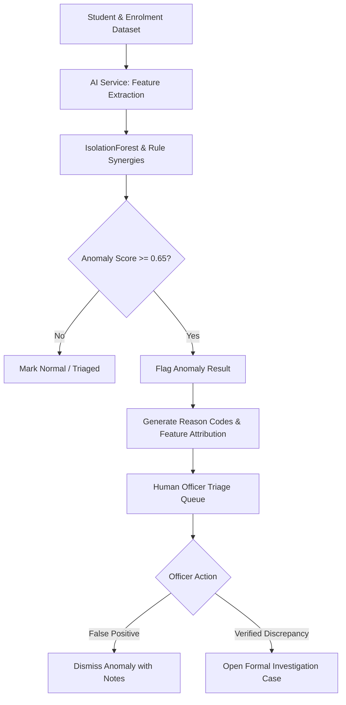

# End-to-End Data Lifecycles & State Transitions

## 1. Unified Student Data Integration Workflow

---

## 2. APAAR Identity Resolution & Conflict Workflow

---

## 3. Admission & Regulatory Compliance Workflow

1. **Intake Limits Check:** Evaluates whether total active enrolments exceed `approved_intake + supernumerary_intake`.
2. **Category Quota Check:** Checks category-specific counts (`GENERAL`, `OBC`, `SC`, `ST`, `EWS`) against sanctioned seats in `programme_intake_categories`.
3. **Cross-Institution Duplicate Enrolment Check:** Detects whether an APAAR ID or student identity is actively enrolled in two institutions during the same active academic year.
4. **Findings Generation:** Violations persist to `compliance_violations` with reason codes (`EXCESS_INTAKE`, `CATEGORY_EXCEEDED`, `CROSS_INSTITUTION_ACTIVE_ENROLMENT`).

---

## 4. AI-Assisted Anomaly Detection & Review Workflow

---

## 5. Investigation Case State Lifecycle

- `OPEN`: Newly created case file triggered by compliance discrepancy, identity conflict, or AI alert.
- `ASSIGNED`: Case allocated to an AICTE Officer or Case Reviewer.
- `IN_REVIEW`: Case under active review; evidence attached and interview notes added.
- `PENDING_INFO`: Awaiting institutional clarification or documentary proof from college.
- `RESOLVED`: Formal decision rendered (`CORRECTION_APPROVED`, `DUPLICATE_CONFIRMED`, `ENROLMENT_CANCELLED`).
- `CLOSED`: Action implemented, audit record finalized.

---

## 6. Academic Verification & QR Lifecycle

1. **Issuance:** Verification Officer selects verified student enrolment and issues a `VerificationReference` with 180-day expiry and max use count (e.g. 10 uses).
2. **QR Generation:** Server generates a QR code containing a secure verification URL with `public_ref`.
3. **Public Lookup:** Employer scans QR code, triggering `GET /api/v1/verifications/public/{ref}`.
4. **Audit Logging:** Access event is recorded in `verification_events` with hashed client IP, timestamp, and status.

